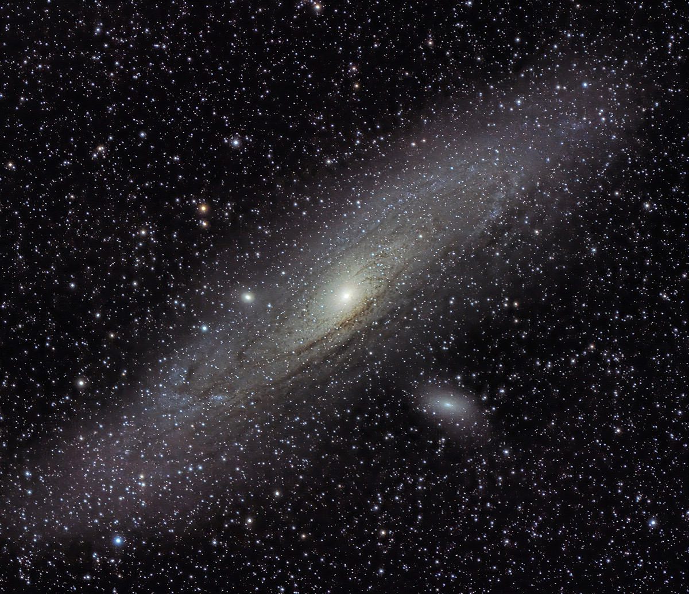

## New iPad
My old iPad Pro finally kicked the bucket after 6 or so years of heavy use so I decided to replace it. I decided that I wanted to use my new iPad for a few things:
- Blogging
- Music recording and mixing
- Drawing
- Video analysis
- Games?
- AI Art Generation?

### Which iPad
I took a look at the currently available iPads to see which one would be ideal for the above use cases:

#### iPad Air
- Same spec as my old iPad Pro, not an upgrade.
- Not compatible with the new pencil
- Screen not as good as the Pro

#### iPad mini
- Too small
- Not compatible with the new pencil

#### iPad Pro
- Powerful
- Uses the new pencil
- Expensive

I decided on the above that while expensive the new iPad Pro would best suit my needs. I will write up on the experience of using the iPad Pro for tasks other than blogging in later posts.

## Blogging
I wont go into the blog itself here as that is covered on a previous entry. What I will cover will be the tools I use to create and post blog entries only using my iPad.

### Shoutout
I have taken a lot of inspiration from the blog post of [Marco Gomiero](https://www.marcogomiero.com/posts/2021/running-blog-ipad/) who put me on to using shortcuts which I will explain briefly.

### Git Client
I could use the official GitHub app for iPadOs but having read the blog mentioned above I wanted to give [Working Copy](https://workingcopy.app/) a try due to its shortcuts integration and ability to work with the Files app native to iPadOs. 

Setting it up was easy, all I had to do was log into my GitHub account and select which repo to clone and within seconds it was checked out and ready to go. I have used the shortcuts from Marco’s blog post to start with, however there were minor alterations because of the differences between Hugo and Jekyll. This post was created using the shortcuts provided by working copy and if it is online then it has worked.

### Editor
This is something that will probably chop and change as I play with different apps but currently I am using [MWeb](https://www.mweb.im/) but I don’t love it or hate it so ill try others probably until I find one that supports my favourite catppuccin theme.

### Images

If that image is visible then it all worked… guess I’ll have to wait till it’s pushed to see.

### Keyboard
The Magic Keyboard for the iPad is surprisingly nice to type with, it is slightly smaller in a few places and its a us layout with the `”,@,#` which is slightly annoying but the typing experience is surprisingly pleasant.

## Conclusion
That is my small post written so I will now push the changes to GitHub and see what it does after posting it to the site, wish me luck.

> Addendum:
I have had to do some work on the shortcuts, the ones I made based of the blog mentioned above were a good starting point but I had to add in an extra couple of steps to check the width of the image before saving it and if necessary to resize it and so that my images are max width `1200px` to keep file size down. The image of Andromeda above was somewhere in the region of 4000 by 3800 pixels and was nearly 9MB now its 1200 by 1200 (ish) and 510KB.
