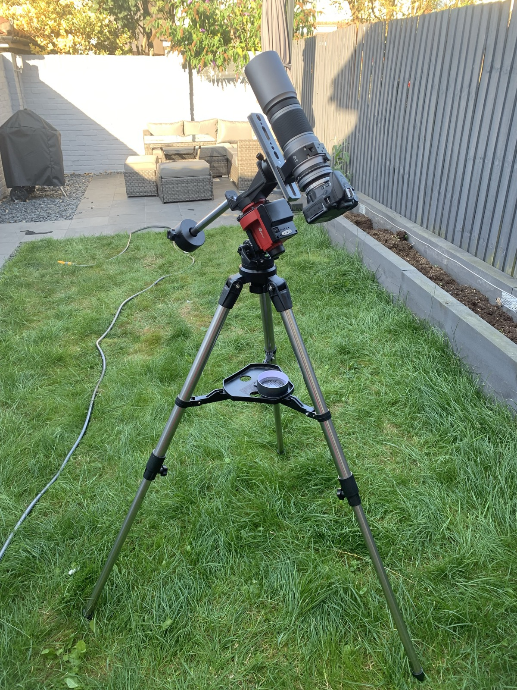

I started astrophotography as a hobby in 2018 with a friend. We initially went out with just a DSLR and a tripod, and the images were a bit of a mess. It turns out it’s actually quite complicated to do. My gallery (of two pictures as of writing) can be found on my [Telescopious](https://telescopius.com/) [Gallery](https://telescopius.com/profile/lunaaeterna)

## Star trackers / mounts
### Why a mount is needed
Turns out, things in space are really far away, who knew? Because of this, the camera needs to be very still when taking images of the sky at night. With a standard tripod and a delay function on the camera it is possible to take photos of the stars, anything longer than a few seconds on your exposure, however, and you will start to get star trails (although this may be what you are aiming for). For deep space you generally (more on this later) want exposure lengths of 5 minutes or longer.

### Tripod
A tripod is a good place to start, this will keep your camera nice and still for your shots but will do nothing to prevent star trails. It is possible with a tripod and a good ball mount for your camera to take a good shot of something like Andromeda, smaller or further away objects may be harder like Bode's Galaxy or the Soul Nebula. It is possible to take DSO photos with just a tripod however, it requires hundreds of photos and constant moving of the camera to keep the object in frame, this is made even more difficult by the fact that a lot of what you will want to take a photo of will be invisible to the naked eye. I have found Andromeda before but only when I was out in the countryside during a new moon and even then it was almost impossible to keep track of.

### Basic star tracker
Basic star trackers mount on to tripods and when aligned correctly to the celestial pole rotate the camera in time with the rotation of the Earth, this allows you to have much longer exposures to get a great deal more light data. A star tracker like the [iOptron Sky Guider Pro](https://www.ioptron.com/product-p/3550.htm) is a great starting point for DSO photography, with one of thesetelescopius link, I have been able to get 10 minute exposures without any blurring or star trails. Some of these basic mounts, including the Sky Guider Pro, can perform basic tracking but only on one axis (more on tracking in the next mount section). This type of mount is relatively inexpensive, the package I use cost less than £200 and even the more expensive ones are under £1000.

### Goto mount
A GOTO mount like the [ZWO AM3](https://www.zwoastro.com/product/zwo-am3-harmonic-equatorial-mount/) can be hooked up to a plethora of software or a mini controller like the [ZWO ASIAIR](https://www.zwoastro.com/product-category/asiair/) and once aligned can be told to ‘go to’ a particular DSO. They can also be set to track that object using a guiding scope and camera, usually a low resolution camera and small telescope hooked up to the controller or a computer. This not only allows for excellent tracking but can also introduce dithering (to prevent sensor or lens issues appearring in the final image). Another advantage of these is that they can, using the software, align themselves using plate solving, where it takes a photo with the guide camera and uses stellar cartography to identify what it is pointing at so it can self-align. Goto mounts are a lot more expensive and almost always require external power, whether from a mains supply or from a portable battery pack, these mounts are generally over £1000 and I have seen some that cost over £8000.

## Cameras
When it comes to astrophotography there are many camera options from using a DSLR to dedicated actively cooled astrophotography cameras, here is a brief overview of the options available.

### DSLR
I use a DSLR (Nikon D5600). It is a cropped sensor reasonably priced camera that I bought specifically for astrophotography use. Whether it is a full frame or cropped camera they are a good place to start, they are pretty affordable and  have the advantage of being able to be used for other photography types as well. If planning to go down this route either because you already have a DSLR or want to use it for other things as well there are a few things to consider:
- The lenses that come with them will almost certainly not be usable for DSO due to being too slow and not having enough “zoom”.
- There are dedicated astrophotography cameras like the [Cannon Eos Ra](https://www.canon.co.uk/cameras/eos-ra/) or the [Nikon D810A](https://www.nikonusa.com/p/d810a-refurbished/1553B/overview) (discontinued). These are good for astrophotography use but almost unusable for general use, I have not personally tried them however this is from reading reviews online.
- They may not be compatible with the controller tools and software used for the mounts so it is worth checking before buying.
- DSLRs use a different lens mounting system for each brand and most astrophotography scopes and lenses use a standard m42 connector so adapters will be needed.
- Autofocus will not work on dedicated astrophotography lenses either a dedicated external autofocus tool is needed or you will need to focus manually.

### Dedicated astrophotography cameras
The dedicated cameras come in many flavours, there are colour, monochromatic, cooled, uncooled, etc…. The most expensive are generally the colour, actively cooled cameras, especially the high resolution full frame ones as these are often considered to be the ideal sweet spot between quality and convenience. Monochromatic cameras are generally paired with either a single filter at once to capture different parts of the light spectrum or used with something like [this](https://pegasusastro.com/products/falcon-rotator-2/) which takes a set of filters and they get rotated by the control software when needed. Using this method will give the best results but it does mean that you need an expensive filter rotator, all of the filters, the cables and power supply which makes it a lot less convenient to use. While I currently use a DSLR one of my next planned purchases will be a dedicated camera.

### Guide cameras
A guide camera is essentially any camera that can be hooked up to your guide scope and control system. Dedicated ones are generally in the £150-£300 range and connect via USB with a single cable to the pc or control box. It is worth noting that any old camera will probably do if you have a spare DSLR lying around that can be controlled by your system.

### Film cameras
Film cameras are the hardest to use for astro, you have to wait to see the results so no way of telling whether your camera is even pointed in the right direction or if your exposure times are correct until you get the negatives processed. There is also a lack of clarity as the film just can’t absorb enough light. This again is based on what I have seen on Reddit and astrophotography forums, I am sure it is possible to get some great photos but without being able to process the results in something like Startools I personally can’t see myself even trying.

## Lenses, telescopes and refractors
There are so many different camera lenses and telescopes of varying types that I wont go over all of them just the ones that I have tried.

### Camera Lenses
Some camera lenses can be very good for astrophotography work, for DSO you will need something with a focal length of around 200mm which generally is very expensive but for general night sky shots something like a “[nifty fifty](https://www.nikon.co.uk/en_GB/product/lenses/dslr/af-s-nikkor-50mm-f1.8g-JAA015DA)” is great for a nice wide milky way shot.
<blockquote class="prompt-warning">
If using a camera lens, ensure that vibration reduction (VR) is disabled or it can actually introduce noise.
</blockquote>

### Telescopes
I don’t actually have much experience with using telescopes for astrophotography. When I was picking what glass I would use I found after much research that they tend to be made for viewing rather than imaging and while you can connect a camera with relative ease they are considered slow lenses so it becomes harder to get the long exposure needed.

### Refractors
Refractors like the [Williams Optics Redcat 51](https://williamoptics.com/products/cat-51) are currently my preferred lenses. This was actually the first lens I bought specifically for astrophotography in the SpaceCat variant and I used it to take a great (at least I think so) picture of the Andromeda galaxy (see the cover image for this post). It is a triplet APO refractor and all I understand about that is that it uses three lenses, it is very fast and is actually recommended for nature and sport photography as well. It is a very well put together lens and the inclusion of the Bahtinov cap makes focusing very easy when you first set up for a night. Other lenses are of course available, Vixen and Sharpstar both make great ones also. If looking to get into the hobby these lenses might seem expensive but they are a great place to start and unless you drop them are pretty bullet proof, mine sits in a backpack in a padded enclosure and isn’t even scratched after a few years of use. It is also very important to pick one that can capture the targets you are looking at, while I love my SpaceCat it struggles with most galaxies that are not Andromeda and it can only barely handle Triangulum. Ideally I would love a Redcat 91 but currently it is out of my budget but a Redcat 71 may be in my future depending on whether I can find the time to do more shooting this year.

## My setup

This is the setup that I used to take the picture of the Andromeda galaxy. It is a relatively cheap setup (for the hobby).

## Long exposure, ISO, and camera settings
These three sections largely apply to DSLR cameras, as they are what I use.

### General camera settings
First and possibly most importantly is that you need to be shooting in RAW, this preserves the light data better allowing for both stacking (explained later) and for processing and adjusting the image curves. The second most important thing is to disable any vibration reduction or steady hand system in the camera, these are great for general shooting while taking holiday snaps but they can misinterpret the moving of a camera when it’s on a mount and incorrectly adjust your otherwise fine image. In almost all cases you will want to be shooting in bulb photography mode (sensor is exposed as long as you hold the button) as most cameras will not allow you to set an exposure time longer than 30 seconds. Personally I use an intervalometer because it has a nice long cable so I can trigger my photos without imparting any force to the camera and potentially ruin my shot, it also lets me set something like 20 shots at 5 minutes a shot with a 30 second gap between each one so I can set it and then go inside and drink a cup of tea with a book. That last point is especially important as it gives the camera time to write to the memory card between photos. 

### ISO settings
What ISO setting you use depends on how long your exposure is, there are some advanced calculations that you can do to figure out what you need but I find those to be annoying and I don’t really understand them, so I take a few photos and set it as low as I can as generally the lower the better. For my Andromeda shot I believe that it was ISO 800 but for another photo I took of the milky way (which sadly I can no longer find) I had it set to 1600 because I had 2 minute exposures.

### Exposure Times
Exposure times again can be calculated using formulas based on lens, camera, and ISO setting but I honestly prefer to experiment on the night to see how long I can get away with before the stars start to blur or lose definition. I also take into account the amount of light getting into the image, Andromeda for example appears like a large swirl on a RAW photo before being processed with a 10 minute exposure at ISO 800 (on my setup, others may vary depending on light pollution and equipment). My basic premise is that the longer exposure the more light data and therefore more detail you can pick out of the final image, especially colours.

## Calibration frames
Calibration frames are used when stacking to remove aberrations and cover for sensor defects, to a point. They cannot fix grievous issues with the lens or sensor but for minor defects like a single pixel they can really help. This process probably does other calibration that I don’t know about with light levels or similar, I have not yet taken the time to properly research it.

### Dark frames
Dark frames are taken when you do the shoot, they can be reused but it's better not to keep them for too long, I reuse mine for at most 6 months then retake them to ensure they are still “current”. Dark frames ideally should be the same length of exposure you use for the rest of the session but taken with the lens cap on. The idea is that if there is a sensor issue these commonly show up as a differently coloured pixel on the image so these frames can be used by the stacking software to remove those pixels by substituting them for other data where the camera was pointing at the target on a slightly different alignment.

### Light frames
Light frames will show up any debris or imperfections on the lens or between the lens and the camera, particles of dust for instance that would be almost impossible to see in the dark when setting up. Light frames again should be taken at the beginning or end of the session but can also be taken the next day, but only really if you haven’t disconnected your setup. To take the light frames you need to place a piece of white paper or a white piece of cloth over the end of the lens and shine a light over it, this diffuses the light and gives an even picture that will show any particles and debris as shadows.

## Image stacking
I have mentioned a few times in this post taking multiple shots at 10 minute exposure. This is not so I can pick the best one to use, it is because I use a tool called [DeepSkyStacker](https://astrobackyard.com/deep-sky-stacker-settings/) to layer these images on top of each other with my calibration frames to produce one large `.tiff` file that I then process in Startools. The tool allows you to batch import and then go through the images to remove ones that have planes or satellites flying over (happens more often than you would think, unless you are somewhere super remote). It can stack based on a number of algorithms and I keep mine on whatever settings I found when I first started using it in a guide and have not actually explored it too much. It can be quite slow, which is understandable given the file sizes it uses but I have found that It has managed to remove artefacts I found from where I had a speck of dust on the lens. The final `.tiff` image can then be processed in other tools like Photoshop, GIMP, Startools, etc….

## Image processing with Startools
Startools is a great piece of software written by an astrophotographer as a hobby project and a way for them to process their own images, It is free to try but you won't be able to save the result if you don’t have a license. I like the fact that it has a `bin` option which allows you to throw away a percentage of the data before processing, what I like doing is to bin 50-75% of the data, then process the image while keeping a log of what I have done and what settings that I have used, once I am happy with it I reload the image and then go through all of the steps which can take several minutes per one. 

### Basic workflow for Andromeda
(TODO) This will be added when I find my notes from processing that image.

### Other tools
While I love Startools, there are other tools available. Many people like to process their images using Adobe [Photoshop](https://www.adobe.com/uk/products/photoshop.html), [GIMP](https://www.gimp.org/), [Siril](https://siril.org/), [PixInsight](https://pixinsight.com/), and many more. Some of these tools can be quite expensive, like Photoshop and PixInsight whereas Siril and GIMP are free and open source. Of those mentioned Photoshop and GIMP are general image manipulation tools and the others are specifically created for the purpose of processing astrophotography images.

## Useful links and tools
### Telescopius
[Telescopius](https://telescopius.com/) is a great tool for simulating your field of view and when you create an account will allow you to post your images which get plate solved and labelled. It will also allow you to enter in your equipment and location and it can suggest targets you may be interested in.

### Astronomy.tools
[Astronomy.tools](https://astronomy.tools/) is another site that simulates a field of view based on what equipment and target you select.

### Astrobackyard
[This](https://astrobackyard.com) is a blog that has a lot of great beginner tutorials on everything from equipment to setting up for a great photo session. The articles are very informative and the author also puts out a lot of videos with more tutorials and reviews.

### First light optics
[First Light Optics](https://www.firstlightoptics.com/) is a shop where I buy most of my gear. They are based in the UK and when I have had questions they were really helpful over the phone and did not try and upsell me on anything.

### Widescreen Center
[The Widescreen Center](https://www.widescreen-centre.co.uk/) is another shop based in the UK near Cambridge that is also very helpful and have a small showroom you can visit (by appointment only). When I went there in a few years ago to pick up my first star tracker mount (a Vixen Polarie, very inferior to the SkyGuider Pro) they were setting up to view the transit of Venus across the sun so I got to take a look which was pretty awesome.
