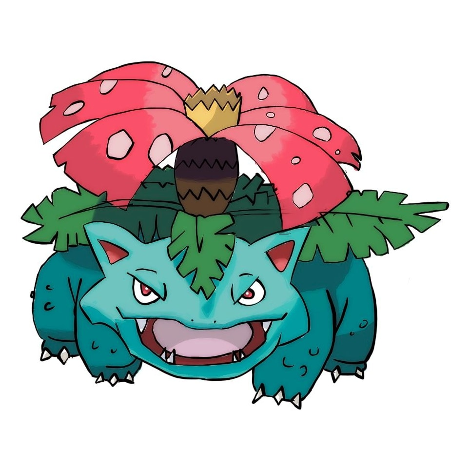

## Previously
### Situation
When I lost my job last year I decided that it was finally time to get round to learning a whole bunch of things. One of them was learning how to draw. In the past I have tried this by following YouTube videos, reading books, following blogs and taking classes. None of these have worked for me and I found myself still in the position where even my stick figures looked bad.

### Goal
My goal is to get to the point where I can draw things that people look at and recognise, that they may even enjoy seeing. I would like to be able to draw cartoons or landscapes without taking days to do a 'quick' sketch.

### Issues
The same problem holds here as I mentioned in my previous post about [music](/posts/clarinet/), I am my own worst critic and always harshly judge my own drawings, seeing every imperfection or jagged line like a personal failing.

I also suffer with dysgraphia, which affects my fine motor control and makes it painful to use a pen / pencil for fine detail for longer than 10 - 20 minutes making regular practice hard.

### The bright idea
I had a brainwave, what do I enjoy that I can draw one of a day, is simple enough to draw quickly and in a cartoon style that I like? The answer of course is Pokémon. If I draw my way through the original (and best) Pokédex then that is 151 pictures to draw, enough to keep me going for half a year and by the end I'll be able to go back and draw them in different poses, maybe draw the shiny versions. The possibilities seemed endless.

## The drawing begins
### How it started
At the beginning I decided to use my iPad and the Procreate drawing tool, allowing me to take advantage of undo and redo and all of the benefits of drawing digitally. I had previously tried with a Wacom drawing tablet but that is only used for osu! now, I do not like drawing but not seeing the results on the surface I am drawing on. I like the screen tablets and may replace the Wacom with a screen / tablet soon. I am looking at the [XP-Pen Artist Ultra 14](https://www.xp-pen.com/series/artist-ultra-series-drawing-display.html) currently but will probably not action on that anytime soon.

Using Procreate was a no brainer, I already had it on my iPad and it is the most raved about app on the platform for drawing. The app is very intuitive and works brilliantly with the Apple Pencil, take this for what it is worth, I am not a professional artist so the fact I like it should in no way influence you. Also bear in mind to use Procreate you need an Apple Pencil compatible iPad so it is much more expensive than the XP-Pen screen tablets.

### My first drawing

I started with Bulbasaur as it is the first one in the 'dex and it took forever to draw. I kept erasing lines and switching tools trying to find one that I could use to sketch the base shape. I vaguely remembered from a previous attempt to learn to draw many years ago that reducing the thing you are trying to draw to simple shapes made it easier or something so that is what I tried. It did not go well and I spent a long time erasing shapes and redrawing them with a variety of tools.

### The first drawing that I liked

I don't like the result of my Bulbasaur and Ivysaur but for some reason I am really happy with my Venusaur. It is one I go back to every so often to apply new tricks that I have learned to improve it or just see how they work on this image. It is the first one I tried to shade as well, you can see from the gallery that many of them I never attempted shading because I find it so hard and time consuming.

## How it's going
### My process
I have managed to get a semblance of a process now: 
1. I start with a reference image taken from [Serebii](https://serebii.net) of the Pokémon I am drawing.
2. I sketch out the outline and major lines of the pokémon (the ones I will later go over in a fine liner).
3. I go over the lines with a fine liner tool to try and get smooth clear lines.
4. I start to colour the image starting by painting the whole thing in its base colour.
5. I add the other colours and details.
6. (optional) I add shading and blending.

Each of these steps I do on a separate layer and then merge them down when I need to, for things like the shading and blending.

### Areas I struggle with
- **Shading:** I suck at shading. Part of it is not understanding the tools so I struggle to blend the colours smoothly, I am looking for a good tutorial for that to hopefully improve.
- **Smooth lines:** This is where my dysgraphia makes things difficult as I struggle with fine motor control. I can do mostly smooth lines but it takes a lot of use of the undo button and redrawing until I am happy with it.
- **Finishing:** I am never sure where to finish a picture. There are always things I can do to improve it and I am not sure where I should stop.
- **Tooling:** I can do most basic things in Procreate but it has a whole plethora of tools that I have not used or tried and didn't understand so I don't use them.

## Future plans
### Tutorials
As mentioned above I am looking for a shading tutorial but that is not the only one. I would like to learn how to use [Krita](https://krita.org/en/) as well as it's FOSS and I will be able to use a drawing screen tablet with it. I also plan to look into some basic drawing tutorials to help me draw smooth lines and sketch the initial layer faster.

### Equipment
I want to purchase a screen tablet like the XP-Pen one mentioned above. This will allow me to draw using my laptop or desktop and I can keep my iPad for drawing on the move. These tablets are built entirely for drawing and I can use them in my day to day work as well for a productivity boost. My other thought has been to get an iPad mini, the iPad Pro I have is an M4 and is very powerful but it is the 13" version which is a bit too big to easily carry around, if I take a big bag it is fine but when I have a laptop already with all my cables, sunglasses, headphones, misc day to day stuff, etc... bag space becomes premium pretty quickly so a smaller tablet will be better for drawing on the go.

### Frequency
Currently I draw once every so often, I would like to do more but I have to be in the right mood to do so, partially because of how critical I am of my drawings, I never feel that they are any good or improving so I have to be in the 'practice' frame of mind, it is the same when I do scales on an instrument.

> I will post updates as I progress in my drawing journey so expect to see more articles when I get a new technique down or do a drawing that I am happy with.
